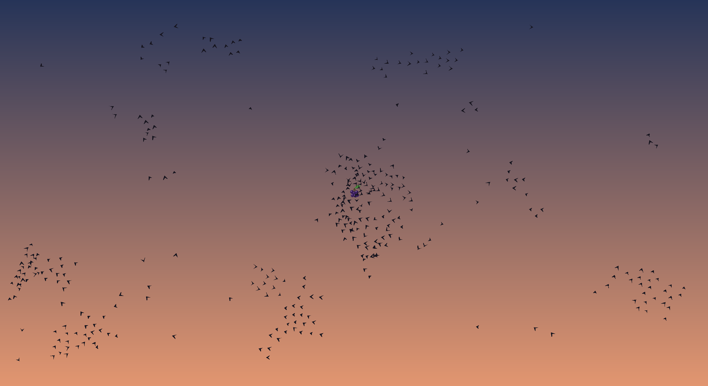

# Boids

A flocking simulation in Python and pygame: a starling murmuration at dusk, built on Reynolds-style separation, alignment and cohesion.



## Run

Requires Python 3.14.

```bash
python3 -m venv .venv
.venv/bin/pip install -r requirements.txt
.venv/bin/python boids.py
```

## Controls

- **Left mouse** — hold to place food; nearby birds gather around it.
- **Right mouse** — hold to become a hawk; birds scatter away.
- **Esc** — quit.

All tunables (flock size, speeds, view radius, rule weights, colours) are constants at the top of `boids.py`.
